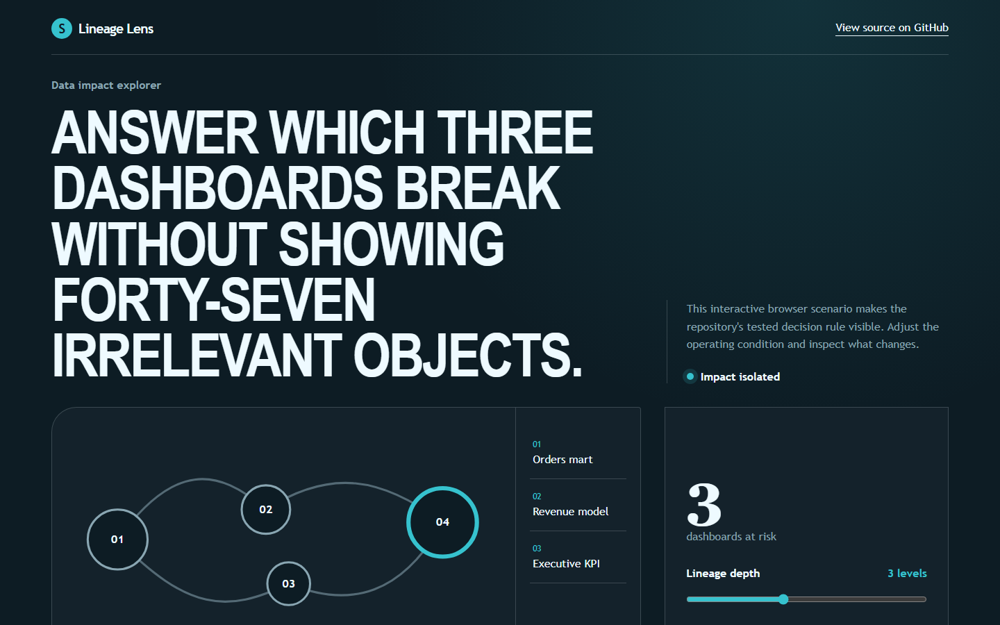
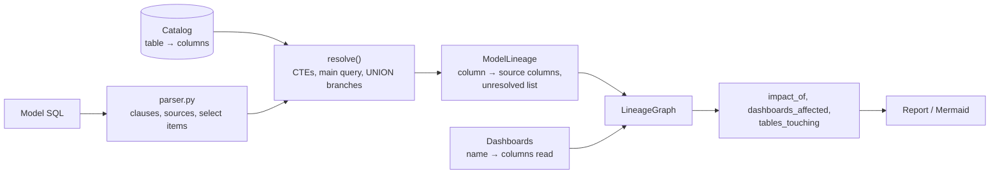

# lineagelens

Column-level SQL lineage and impact analysis: given a column you want to change, it lists the downstream columns and dashboards that read it.

[](https://github.com/SlateGitOrg/lineagelens/actions/workflows/ci.yml)
[Live demo](https://slategitorg.github.io/lineagelens/)



## Why

When someone renames a column in a source table, dashboards downstream can break without anyone noticing until a blank tile shows up. Table-level lineage only says that many objects touch the table. In the bundled demo, ten models touch `orders`, but only six columns and four of five dashboards actually read `orders.discount_pct`. Getting from the first answer to the second means resolving `SELECT *`, CTEs and `UNION`s correctly, which is where most simple tools give up. lineagelens does that resolution with a small parser whose rules you can read.

## Features

- Column-level lineage from SQL, resolved through CTE chains, joins, self-joins (distinct aliases), `UNION` / `UNION ALL`, qualified and unqualified `SELECT *`, expressions and `CASE`.
- `SELECT *` expansion against a table catalog; stars over unknown relations are reported as unresolved rather than silently dropped.
- Transitive impact query: all downstream `(model, column)` pairs for a changed column.
- Dashboard impact: which dashboards read an affected model, compared with the table-level answer.
- Mermaid rendering of one column's downstream graph.
- Standard library only, Python 3.11+.
- A browser demo (`site/`) that lists dashboards depending on a changed column.

## Architecture



`parser.py` splits a query into clauses and extracts sources and column references. `lineage.resolve` resolves CTEs in declaration order, then the main query, then `UNION` branches by position, producing one `ModelLineage` per model. `LineageGraph` joins models and dashboards and answers impact queries. More detail in [docs/ARCHITECTURE.md](docs/ARCHITECTURE.md).

## Quick start

Requires Python 3.11+. There is nothing to install.

```bash
git clone https://github.com/SlateGitOrg/lineagelens.git
cd lineagelens
python3 -m unittest discover -s tests -v   # 18 tests
python3 -m src.demo                        # column-level vs table-level impact
```

The browser demo needs Node.js (any recent version) for its tests:

```bash
node --test site/core.test.mjs
python3 -m http.server -d site 8000        # then open http://localhost:8000
```

## Example

Library use:

```python
from src.fixtures import CATALOG
from src.lineage import LineageGraph, ColumnRef, resolve

graph = LineageGraph(dashboards={"mart_revenue": ["Exec Revenue"]})
graph.add(resolve("select o.id, o.gross_amount - o.discount_pct as net from orders o",
                  "mart_revenue", CATALOG))
graph.dashboards_affected(ColumnRef("orders", "discount_pct"))  # ['Exec Revenue']
```

`python3 -m src.demo` prints (trimmed):

```text
  An engineer proposes renaming `orders.discount_pct`.

  WHAT A TABLE-LEVEL TOOL REPORTS
    10 objects touch `orders`: aggregate_with_group_by, case_expression, cte_chain, ...

  WHAT COLUMN-LEVEL LINEAGE REPORTS
    6 columns read it, transitively:
      case_expression.channel_band
      cte_chain.net_amount
      mart_customer_revenue.revenue
      mart_discount_watch.discount_pct
      stg_orders.discount_pct
      stg_orders.net_amount

    Dashboards affected: CS Account Health, Exec Revenue Summary, Ops Daily Orders, Pricing Governance
    Unaffected:          Geo Mix
```

## How it works

- **Catalog and `SELECT *`.** A star cannot be expanded without the source schema, so `resolve` takes a `Catalog`. `o.*` expands only `o`'s relation.
- **CTE scopes.** Each CTE's lineage is stored as a scope; later CTEs and the outer query resolve references through it down to physical columns.
- **UNION by position.** `SELECT a, b UNION SELECT b, a` is valid SQL; branches are matched to the first branch's output columns by position, not name.
- **Unresolved constructs are surfaced.** An unexpandable star lands in `ModelLineage.unresolved`, since an empty result from a parser gap would read as "safe to change".
- **Transitive impact.** `impact_of` walks `(model, column)` edges to a fixed point.

## Testing

```bash
python3 -m unittest discover -s tests -v
```

The suite checks exact lineage for every annotated fixture query in `src/fixtures.py` (expected lineage is written by hand next to each query) and has explicit tests for star expansion, qualified stars, CTE chains, positional `UNION`, self-joins, function names and string literals not being read as columns, comments, and impact/dashboard queries. CI also runs `node --test site/core.test.mjs` and a site validation script.

## Project layout

```
src/
  parser.py     clause splitting, FROM sources, select items, column refs
  lineage.py    Catalog, resolve(), LineageGraph, Mermaid rendering
  fixtures.py   annotated SQL fixtures, catalog, dashboards
  demo.py       runnable column vs table impact demo
tests/          unittest suite
site/           static browser demo (deployed to GitHub Pages)
docs/           architecture notes and screenshots
```

## Limitations

- The parser handles a focused subset of analytics SQL; it is not a full dialect grammar (no window frames, lateral joins or dialect-specific syntax). A library like SQLGlot would be the next step for broader coverage.
- Dashboards and the catalog are supplied as input; there is no dbt manifest or BI tool integration, and no CLI.
- The browser demo uses a simpler regex-based reference extraction than the Python library and matches dashboards by exact column name.

## License

MIT — see [LICENSE](LICENSE).
