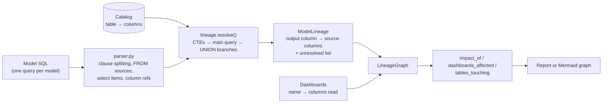

# Architecture

## Context

Renaming or dropping a column in a warehouse table can silently break the
dashboards built on top of it. Table-level lineage only says that "ten objects
touch `orders`". lineagelens answers the narrower question that matters in code
review: which specific columns, and which dashboards, read *this* column.

## Container view

## Key decisions

- **Column level, not table level.** The graph's nodes are `(model, column)`
  pairs. Impact is a transitive walk over those nodes, then a lookup of which
  dashboards read any column in the impact set.
- **A catalog is required for `SELECT *`.** A star cannot be expanded without
  knowing the source schema. Qualified stars (`o.*`) expand only that relation.
- **CTEs resolve first, in declaration order.** Each CTE becomes a scope that
  later CTEs and the outer query read from, so lineage passes through to the
  physical column.
- **UNION branches match by position.** `SELECT a, b UNION SELECT b, a` is
  legal; matching by name would invert the lineage.
- **Unresolvable constructs are reported.** A star over an unknown relation is
  recorded in `ModelLineage.unresolved` instead of contributing nothing, because
  "no downstream consumers" produced by a parser gap looks like good news.
- **Standard library only.** The parser is a small purpose-built subset so the
  resolution rules are easy to read and test. The trade-off is coverage of SQL
  syntax; see Failure modes.

## Failure modes

- SQL outside the supported subset (window frames, lateral joins, dialect
  specific syntax) may be mis-parsed. The test suite pins the supported cases.
- Unknown relations under `SELECT *` are listed as unresolved.
- Dashboards are an input (name → columns), not discovered from a BI tool.

## Out of scope

- Dialect-complete SQL parsing (a library such as SQLGlot would be the next step).
- Reading dbt manifests or BI tool metadata.
- Persisting the graph or serving it over a network.
